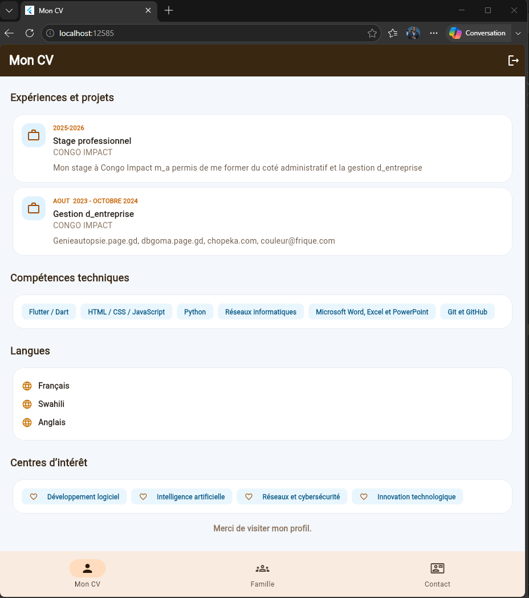
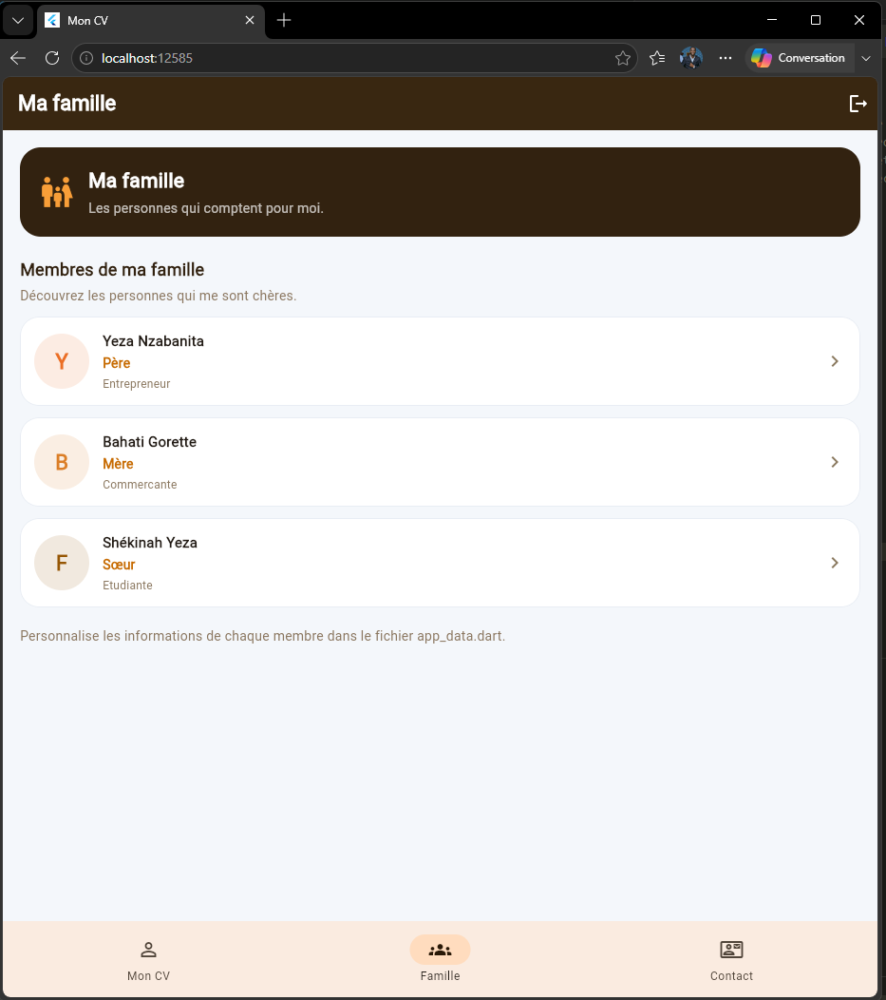

<video controls width="640">
  <source src="capture/VIDEO.MP4" type="video/mp4">
  Votre aperçu Markdown ne prend pas en charge la lecture vidéo.
</video>

[Ouvrir ou télécharger la vidéo](capture/VIDEO.MP4)